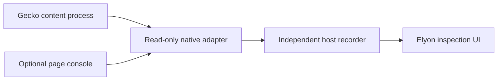

# Gecko integration: a separate engine project

Research checked 2026-11-07. No native Gecko integration is implemented in this PR.

Gecko is a native rendering engine, not a script the console can import.
[Mozilla's GeckoView SDK](https://firefox-source-docs.mozilla.org/mobile/android/geckoview/index.html)
is an Android embedding API. Its Android examples cannot be pasted into an iOS
project. The inspection UI should remain engine-independent.

## What Reynard establishes

[Reynard](https://github.com/minh-ton/reynard-browser) demonstrates an experimental
Gecko host on iOS. At reviewed commit `8ded3486821e6c922b5f2985274aefdc86752344`,
its implementation includes Swift session/runtime wrappers, helper extensions,
XPC plumbing, engine patches, and JIT setup. It builds with Xcode and a patched
Gecko toolchain. Its GPLv3 host and MPL2 engine patches require separate license
review before reuse. Reading this source is not equivalent to importing a tested SDK.

Useful integration seams in that pinned tree:

- `browser/GeckoView/Session/GeckoSession.swift`: per-session lifecycle and dispatch.
- `browser/GeckoView/Addons/AddonMessaging.swift`: extension/native message delegation.
- `browser/Helper/ExtensionBridge.mm`: native helper connection plumbing.
- `patches/mobile/shared/modules/geckoview/GeckoViewRemoteDebugger.sys.mjs.patch`:
  an iOS-specific remote-debug transport change. Do not enable it for arbitrary
  network peers; it needs a separate pairing and authorization design.

These are research seams, not verified public APIs for Elyon. No Reynard code
or engine binaries are copied into this repository.

## Two routes worth pursuing

1. **Experimental Reynard integration.** Build the pinned upstream on a Mac and
   physical supported iPhone first. Add a read-only Elyon inspector as a developer
   feature in a separate branch. Test a bundled extension/native delegate before
   touching privileged network actors. Keep this separate from a public release
   commitment; upstream build/install constraints and engine maintenance apply.
2. **Entitled alternative-engine browser.** Apple's official pathways have regional,
   app, engine, and security requirements. The [EU requirements](https://developer.apple.com/support/alternative-browser-engines/)
   and [Japan requirements](https://developer.apple.com/support/alternative-browser-engines-jp/)
   are distinct; Japan's documented pathway starts at iOS 26.2. BrowserEngineKit
   adoption and entitlement approval are an engineering/distribution project, not
   a universal setting available to every iPhone app. The embedded-engine route
   also has engine-steward eligibility requirements.

Recommendation: keep shipping the engine-neutral UI while validating the first
route as a research spike. Decide the intended devices and distribution model
before committing to a native fork. Do not replace the tested desktop source
labels with Gecko labels to suggest support that has not been measured.

## Proposed adapter contract and gates

The recorder and inspector controls must not depend on the inspected page's
JavaScript thread. A Python broker is not an iOS shipping plan: port the bounded,
append-only protocol implementation to a native host, with the current Python
implementation and archive fixtures as the reference for conformance.

- Bind a capture to a concrete browser session, document generation, process, and
  source. Navigation invalidates activation; record explicit detach/restart gaps.
- Keep native observations separate from page-instrumented Fetch/XHR. Matching
  URL and time alone must never establish request identity or response exposure.
- Preserve decimal uint64 sequences, bounded batches, explicit credit, fsync-before-
  acknowledgement, and stop controls that do not await content execution.
- Expose only the capabilities each adapter actually validated. Chii's JavaScript
  CDP-like implementation is not Firefox's native remote debugging protocol.
- Scope native delegates to a specific extension ID, origin, target, and session;
  never provide arbitrary pages a general native command endpoint.

The first physical-device acceptance run must cover redirects, frames/workers,
service workers, memory pressure, navigation during a response, content hangs,
process death, reconnect, and exported evidence replay. Compare iOS versions and
JIT modes. Record unsupported cases explicitly. A Linux Chromium test does not
satisfy any native iOS gate.
