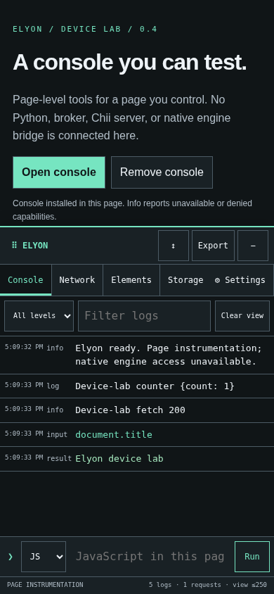
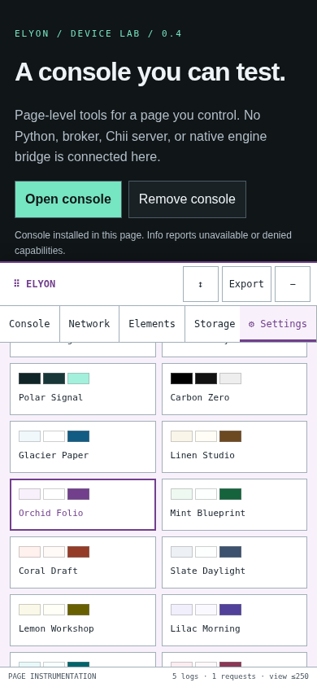
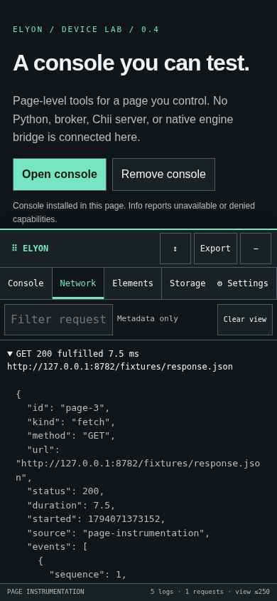

# iPhone-console engineering verification — 0.4.0

Verified in the managed Linux environment on 2026-11-07. The untouched merged-main
baseline and its twelve newly executed checks are recorded separately in
[BASELINE-IPHONE.md](BASELINE-IPHONE.md). Older recovered RESULT/VALIDATION files
are historical evidence, not proof of this release's behavior.

## Final local results

Every command below passed. Python checks used the pinned `.venv` development
versions. Local browser checks used system Chromium with its sandbox enabled.

| Exact command | Actual result |
| --- | --- |
| `python tools/check_recovery.py` | All 84 original upload hashes verified; 60 ordered patches preserved |
| `npm run check:themes` | All 20 existing palettes unchanged; minimum checked text contrast 6.03:1 at full opacity |
| `npm run format:check` | All matched JS/CSS/HTML/tool files formatted |
| `npm run build:demo` | Standalone static device lab built successfully |
| `python -m unittest discover -v` | 41 tests passed; 2.78 seconds |
| `python -m mypy elyon` | Passed, 10 source modules |
| `python -m ruff check .` | Passed |
| `python -m ruff format --check elyon tests validation tools` | Passed |
| `python -m build` | 0.4.0 source distribution and wheel built |
| `npm audit --omit=dev` | Zero reported vulnerabilities |
| `git diff --check` | Passed |
| `python tools/run_browser_checks.py` | All four explicit browser checks below exited 0 |
| `python -m unittest validation.iphone_regression.IPhoneConsoleRegression.test_redaction_snapshot_integrity_and_no_independent_claim -v` | Passed again after final coverage metadata was added |

The browser runner owns its loopback-only workbench/Chii processes and writes
command/exit/duration records to `artifacts/browser-checks/results.json`:

| Command executed by runner | Actual result | Seconds |
| --- | --- | --- |
| `python -m unittest validation.browser_check -v` | Both tests passed, including 100 redirects, independent controls during a 5-second stall, renderer death, cache/SW/CSP/frame/worker/late-response fixtures | 24.48 |
| `python -m unittest validation.iphone_regression -v` | All 23 regression tests passed | 41.60 |
| `python validation/workbench_check.py` | Two distinct consecutive captures, filtering/details, archive download/import, mobile layout, Chii target, and actual DevTools Elements window passed | 24.07 |
| `python validation/mobile_console_check.py` | Original phone-sized interaction script passed; no browser page errors | 4.58 |

Browser CI installs Playwright's pinned Chromium and sets
`ELYON_CHROMIUM_EXECUTABLE=bundled`. The same flag is supported by the desktop
harness and UI scripts. A missing browser is an explicit failure, not a silent skip.

## Regression coverage

The new suite exercises Fetch body nonconsumption, exact Response/error objects,
synchronous throws, native URL/getter invocation counts, rejected/aborted requests,
HTTP errors and opaque fulfilled responses. XHR tests compare user event sequences
with an uninstrumented control; reuse in DONE/load/loadend, synchronous nested reuse,
invalid calls, abort/timeout/network errors, and denied listener installation are
covered. Pending-XHR listener removal, fifteen reinstall cycles, and respecting
later page wrappers are checked.

UI coverage includes async evaluation and readable errors, explicit CSP denial,
bounded getter-safe/circular/Proxy previews, DOM metadata/highlight/picker cleanup,
storage edits/deletion and denial, blocked styles, all themes/persistence,
320/360/375/390/414/430/440px layouts, pointer dragging/resizing, keyboard navigation,
and reduced visual-viewport paths down to 180px. Redacted exports and raw snapshot
copy integrity are tested. The static distribution's asset hashes are checked, and
the actual Node preview is checked to have no `/api/state` or `/command` endpoint.

## Failures found and fixed during development

- A baseline probe observed native XHR statuses `[200,404]` but recorded `[0,0]`
  under request reuse. The recorder now preserves actual observations and reports
  a gap if reuse prevents observing a later completion phase.
- Initial expanded tests caught a native DOMException preview that showed only a
  stack accessor marker; native exception names/messages now display safely.
- The complete runner exposed stale workbench success state during a new capture.
  Status is now tied to run ID/generation and verified across consecutive runs.
- Active-panel-only rendering exposed an immediate DOM-count assertion in the old
  mobile script; it now waits for the actual rendered rows before checking count.
- The opaque-response fixture initially left network capture disabled from its
  preceding persistence check; its setup now explicitly reenables capture.

These failures are not omitted from the record; the final checks above passed.

## Limits of this verification

The phone UI tests use Chromium touch/viewport emulation. Reduced viewport tests
exercise the visualViewport path but do not generate a physical iOS keyboard.
No physical iPhone, iOS 27, Safari/WebKit, or Reynard/Gecko native validation was
performed. The static Pages workflow is provided but has not been deployed or
validated against the user's Pages configuration; there is no claimed live URL.

The page console shares the page thread, changes API function/Promise identity and
some timing, and has bounded volatile retention. It captures no response bodies or
headers. Native engine access, independent page provenance, secure remote pairing,
and a Chii-to-broker adapter remain unavailable. See [the observation contract](PAGE-INSTRUMENTATION.md).

## Actual standalone demo previews

These show observed fixture activity in Chromium emulation, not physical-device evidence.

| Console | Settings |
| --- | --- |
|  |  |

For reproduction and on-device steps, see [IPHONE-TESTING.md](IPHONE-TESTING.md).
